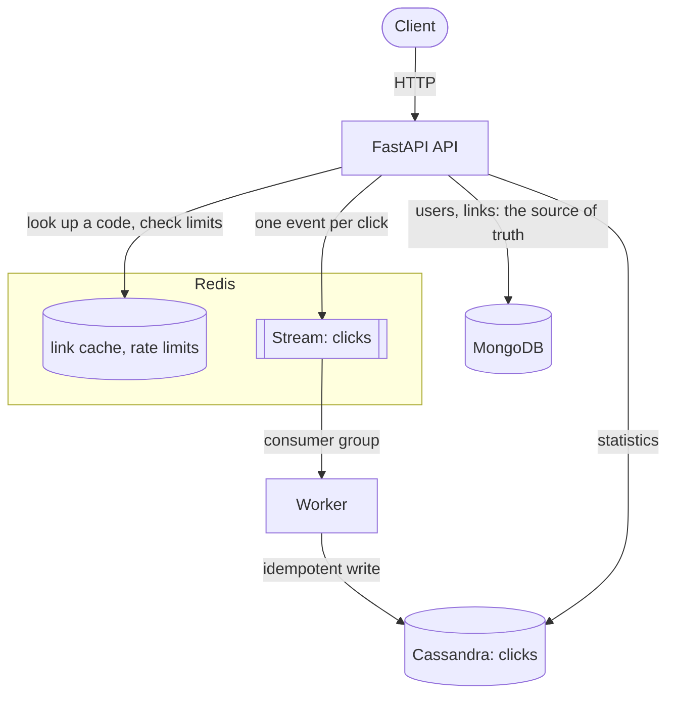
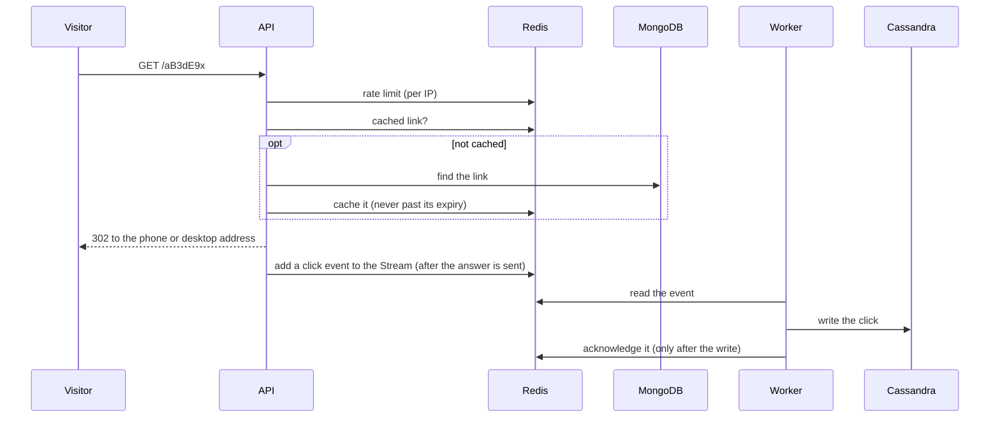

# tinyurl-py

[](https://github.com/nemiys/tinyurl-py/actions/workflows/ci.yml)

A URL shortener with **smart links**: one short link can send phones to a
different address than desktops, and can stop working at a set time. Every
click is counted, and the owner sees clicks per day.

A Python rewrite and upgrade of a course project (Java/Spring). The point is
sound backend fundamentals (REST, authentication, one error format, tests, CI)
and system design whose choices are explained: which data store holds what,
where the cache sits, and how counting a click never slows down the redirect.
Every significant decision is recorded in [`docs/adr/`](docs/adr/README.md).

## Quick start

Requires Docker with Compose. Nothing else.

```bash
docker compose up --build
```

This starts MongoDB, Redis, Cassandra, the API and the worker that counts
clicks. The first start takes a minute or two, mostly Cassandra booting.
Then open the interactive API docs at **http://localhost:8001/docs**.

For something to look at right away, load the demo data: a user, four links
and two weeks of clicks.

```bash
docker compose run --rm api python -m tinyurl_py.seed            # create
docker compose run --rm api python -m tinyurl_py.seed --remove   # remove it again
```

Log in as `demo@example.com` / `demo-password-123`, then try
http://localhost:8001/Demo002 from a phone and from a desktop, or
http://localhost:8001/Demo004, which has expired and answers `410 Gone`.

Without a `JWT_SECRET` (see [`.env.example`](.env.example)) each run makes a
random one, so logins end when the containers restart.

## Try it

The whole flow with `curl` (and [`jq`](https://jqlang.org/) to pick values out
of the answers):

```bash
API=http://localhost:8001

curl -s -X POST $API/auth/register -H 'Content-Type: application/json' \
  -d '{"email": "dana@example.com", "password": "correct horse battery staple"}'

TOKEN=$(curl -s -X POST $API/auth/login -H 'Content-Type: application/json' \
  -d '{"email": "dana@example.com", "password": "correct horse battery staple"}' | jq -r .access_token)

CODE=$(curl -s -X POST $API/links -H "Authorization: Bearer $TOKEN" \
  -H 'Content-Type: application/json' \
  -d '{"url": "https://example.com/", "mobile_url": "https://example.org/"}' | jq -r .code)

curl -si $API/$CODE | grep -i location                      # desktop: https://example.com/
curl -si -A 'Mozilla/5.0 (iPhone) Mobile' $API/$CODE | grep -i location   # phone: https://example.org/

curl -s $API/links/$CODE/stats -H "Authorization: Bearer $TOKEN" | jq   # total_clicks: 2
```

Counting survives the worker being down. Stop it, click, start it again: no
click is lost and none is counted twice.

```bash
docker compose stop worker
for i in $(seq 10); do curl -s -o /dev/null $API/$CODE; done
docker compose start worker      # a moment later the statistics show 10 more
```

## Architecture



| Store | Holds | Why this one |
|---|---|---|
| **MongoDB** | users and links | The source of truth. Unique indexes on the email and the short code are what really guarantee "one of each", even for two requests at the same moment. ([ADR-0005](docs/adr/0005-mongodb-for-users-and-links.md)) |
| **Redis** | the link cache, rate-limit windows, the click queue | Fast and already there. Never the source of truth: every Redis failure falls back to Mongo or lets the request through. ([ADR-0010](docs/adr/0010-cache-aside-with-a-bounded-time-limit.md), [ADR-0003](docs/adr/0003-sliding-window-rate-limiting.md)) |
| **Cassandra** | one row per click | Built for a stream of writes. The table is shaped around the one question asked, "clicks of link X on day Y". ([ADR-0002](docs/adr/0002-cassandra-for-clicks.md)) |

The API and the worker are the same image with a different command.

## What happens on a click



- **The visitor never waits for the counting.** The answer goes out first; the
  event is added to the Stream afterwards, and a separate worker writes it to
  Cassandra. ([ADR-0001](docs/adr/0001-redis-streams-over-kafka.md))
- **No click is lost.** The worker acknowledges an event only after Cassandra
  has it. If the worker crashes in between, the event stays pending and is
  processed again; a worker that dies for good has its events taken over by
  another.
- **No click is counted twice.** Each event carries its own id and time, and
  they form the row's key. Writing the same event again overwrites the same
  row instead of adding one.
- **`302`, not `301`**, so browsers do not remember the redirect and every click
  comes back to be counted. ([ADR-0007](docs/adr/0007-redirect-with-302.md))
- A deleted link answers `404` and an expired one `410`; both keep their
  statistics. ([ADR-0008](docs/adr/0008-soft-delete-for-links.md))

## API

| Method and path | What it does | Login |
|---|---|---|
| `POST /auth/register` | Create an account | |
| `POST /auth/login` | Get a token (`Authorization: Bearer ...`) | |
| `GET /me` | The logged-in user | ✓ |
| `POST /links` | Create a short link: `url`, optional `mobile_url` and `expires_at` | ✓ |
| `GET /links` | Your links, a page at a time: `limit`, `offset`, `status` (`all`, `active`, `expired`), `order` | ✓ |
| `GET /links/{code}` | One of your links | ✓ |
| `GET /links/{code}/stats` | Total clicks and clicks per day (`days`, up to 90) | ✓ |
| `DELETE /links/{code}` | Delete a link (it keeps its statistics) | ✓ |
| `GET /{code}` | The redirect: `302`, or `404` / `410`. `HEAD` gets the same answer and is not counted as a click | |
| `GET /health`, `GET /ready` | The process is up / it can reach MongoDB | |

Another user's link answers `404`, exactly like a code that does not exist, so
the API never reveals which codes are taken.
([ADR-0009](docs/adr/0009-authentication-argon2-and-jwt.md))

Every error has the same shape, with a stable `code` to switch on:

```json
{"error": {"code": "unsafe_destination", "message": "url points to an internal address"}}
```

Validation errors add `details`, one entry per bad field.
([ADR-0004](docs/adr/0004-uniform-errors-and-destination-checks.md))

## Protections

- **Rate limits** (sliding window in Redis; a refusal is `429` with `Retry-After`):

  | What | Counted per | Default |
  |---|---|---|
  | Creating links | user | 20 per minute |
  | Redirects | IP address | 120 per minute |
  | Login | IP address | 10 per minute |
  | Registration | IP address | 10 per hour |

- **Only public destinations.** Links to `localhost`, private networks, cloud
  metadata addresses, or names that resolve to any of them are refused, including
  disguised forms such as `http://2130706433/` (which is `127.0.0.1`).
- **Passwords** are hashed with argon2. A login with an unknown email takes as
  long as one with a wrong password, so timing does not reveal who is registered.
- **Short codes** are 7 random characters from a secure random source (about
  3.5 trillion possibilities), so links cannot be guessed or enumerated.
  ([ADR-0006](docs/adr/0006-random-short-codes-with-a-unique-index.md))

## Tech stack

| Layer | Technology | Why |
|---|---|---|
| API | FastAPI (async), Pydantic | Request validation and the OpenAPI docs come from the same type hints |
| Links, users | MongoDB, `pymongo` async client | A link is one document; unique indexes guarantee uniqueness |
| Cache, limits, queue | Redis, `redis` async client | One small, fast service for three short-lived jobs |
| Clicks | Cassandra, `cassandra-driver` | Many small writes, read back one link and one day at a time |
| Security | `pwdlib` (argon2), `PyJWT` | Slow password hashes; signed, stateless tokens |
| Configuration | `pydantic-settings` | Environment variables, checked at start-up |
| Tooling | `uv`, `ruff`, `mypy` (strict), `pytest` | One lockfile, lint and format, full typing, tests |

## Project structure

```
src/tinyurl_py/
  api/          routers, request and response shapes, dependencies, error handlers
  domain/       pure logic: short codes, device detection, destination checks
  security/     passwords, tokens, the rate limiter
  cache/        the Redis link cache
  events/       the click event and how it is published
  persistence/  MongoDB, Redis and Cassandra connections, the click store
  worker/       the Stream consumer and its entry point
  seed.py       the demo data
cassandra/      schema.cql, applied by the cassandra-init service
docs/adr/       architecture decision records
scripts/        smoke test of the running containers (CI runs it on every push)
tests/          unit/ and integration/ (integration needs the databases running)
```

## Development

The databases in containers, the code on your machine:

```bash
docker compose up -d --wait redis mongo cassandra cassandra-init
cp .env.example .env        # then set JWT_SECRET (at least 32 characters)
uv sync

uv run uvicorn tinyurl_py.main:app --reload --port 8001
uv run python -m tinyurl_py.worker
```

Checks, the same ones CI runs:

```bash
uv run ruff check .
uv run ruff format --check .
uv run mypy src tests
uv run pytest --cov          # fails below 95% coverage

docker compose up -d --build --wait
bash scripts/smoke_test.sh   # the built image, end to end (needs curl and jq)
```

The tests use their own MongoDB database (`tinyurl_test`) and Redis database
(15), wiped around every test, and remove every Cassandra row they write.

Host ports are deliberately not the defaults, so this can run next to other
projects: API 8001, MongoDB 27018, Redis 6381, Cassandra 9043.

## Design decisions

Each significant choice is recorded in [`docs/adr/`](docs/adr/README.md): what
was decided, what else was considered, and why. Not a changelog: one record per
decision that would be expensive to reverse.

## License

[MIT](LICENSE)
